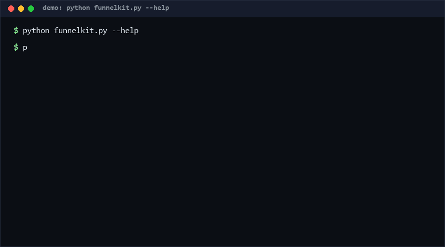

# awesome-funnel-design

Turn a curated list repo into a measurable funnel instead of a static wall of links. Validate manifest structure (including sponsorship disclosure), then track exposure, click and conversion events per entry and see which links actually earn their placement. No marketing copy, no real list data — engineering only.

Pattern version: **0.1** · Data currency: **as of 2026-10-11**.

<p align="center"></p>

## Problem

Curated lists are the most common open-source content asset, and almost all of them are unmanaged: links rot silently, placement is arbitrary, and maintainers who do monetize (sponsor slots, their own products pinned at the top) rarely publish the numbers. The 2026 state of the art — large awesome-lists carrying paid slots and maintainer-owned app walls as first-screen inventory — shows a list *can* be a sustainable funnel. What's missing is the boring engineering layer: structure validation with disclosure checks, and a metrics loop that works without shipping any marketing content or tracking users.

## How it works

**Manifest contract** — a list is a JSON document with mandatory disclosure:

```json
{"meta": {"title": "...", "disclosure": {"sponsored_slots": 4,
                                          "owned_products_listed": 1}},
 "categories": [{"name": "editors",
                 "entries": [{"name": "tool-a", "url": "https://...",
                              "sponsored": false,
                              "owned_by_maintainer": false}]}]}
```

- `validate` — structure check: every entry has a name and a valid http(s) URL; `sponsored` / `owned_by_maintainer` flags must be explicit (absent flags produce warnings, not silent defaults); declared `sponsored_slots` must cover the sponsored entries actually present. A monetized list that fails disclosure is structurally broken, in this tool's opinion.
- `track` — ingest a JSONL event stream (`{"ts", "entry", "event": exposure|click|conversion}`) and compute per-entry and total `ctr = click/exposure` and `cvr = conversion/click`. Corrupt lines are counted and skipped, never fatal.

Metric definitions are fixed and printed with every report (`ctr = click/exposure`, `cvr = conversion/click`) so numbers from different maintainers are comparable.

## Quickstart (~3 min)

```bash
# Step 1: validate your list manifest (~1 s)
python funnelkit.py validate --manifest my-list.json

# Step 2: compute funnel metrics from an event log (~1 s)
python funnelkit.py track --events events.jsonl

# Machine-readable variant (~1 s)
python funnelkit.py track --events events.jsonl --json

# Full self test (~15 s)
python self_test.py
```

## Why not X

| Alternative | Why not |
|---|---|
| Web analytics (GA-style) on the rendered page | Tracks the *page*, not the *list entries*; heavy, cookie/privacy-laden, and useless for API/README-consumed lists. |
| Affiliate-link platforms | They bundle tracking with monetization and lock the list into one vendor; here tracking is a plain JSONL log you own. |
| Ad-hoc spreadsheet of clicks | No schema, no disclosure checks, no entry-level breakdown, dies with the maintainer's motivation. |
| Full martech suites | Built for campaigns and funnels with landing pages; a list repo needs three event types and two ratios, not a CDP. |

## Minimal Fallback

No Python? The manifest contract above is one JSON block (any editor can lint it), and the funnel math is two divisions — `grep -c exposure events.jsonl` style counting gets you 80% of the value. `validate --json` output is plain JSON for any CI.

## Design Trade-offs

Priority: **disclosure integrity > metric comparability > simplicity > coverage**. Concretely: disclosure fields are mandatory in the schema even for non-monetized lists (explicit `false` beats implicit absence — an honest zero); fixed ratio definitions over configurable ones (comparability beats flexibility); client-side log ingestion over any embedded tracking (no cookies, no beacons, no third parties — the repo ships zero marketing content by construction).

## Limits & Second-order Effects

- Three event types only: no dwell time, no scroll depth, no A/B machinery.
- `exposure` semantics are the reporter's responsibility (a README render? a category view?); cross-list comparisons are only valid when exposure definitions match.
- **Second-order effects**: publishing per-entry metrics changes curator behavior — entries drift toward what clicks (popularity bias), niche-but-valuable links get culled, and maintainers may be tempted to inflate exposure counts since the denominator is self-reported. If disclosure checks become common, expect performative compliance ("sponsored: false" on undeclared deals). Metrics make a list measurable, not honest; disclosure review stays human.

## FAQ

**When NOT to use this toolkit?** Lists under ~50 entries with no monetization plans (the overhead buys nothing); lists consumed only via git clones (no exposure events to track); and any context where you want *behind-a-login* analytics with user-level tracking — this deliberately does not and will not do that.

**Does this include ad copy or real list data?** No. The repo ships validators and a metrics spec only; all fixtures in tests are invented. What you track and how you position entries is your content, not ours.

**Is this a tracker?** No. There is no beacon, cookie, or network call. You (the maintainer) log events however you legally can and feed the file in — privacy compliance is entirely in your hands and your jurisdiction.

**Why are absent boolean flags warnings rather than errors?** Because forcing a flag rewrite would break thousands of existing lists instantly. Warnings nudge adoption; the schema still treats explicit `false` as the only honest zero.

**How do I collect exposure events without a tracker?** Log server-side what you already control: README fetches, docs-site page views per section, or CI-render counts — whatever you can measure without adding client-side beacons. Then document your exposure definition next to the report; a number without its denominator definition is not comparable to anyone else's.

Confidence: **High (>=80%)** that validate/track implement the documented contract (fully unit-tested). **Medium (60–79%)** that three event types suffice for list curation decisions — derived from this pattern class, not measured across many lists `[estimated]`.

## [Core Assumptions]

1. Exposure, click and conversion are the minimal event vocabulary for list curation; richer signals are optional, not structural.
2. Maintainers will adopt disclosure fields only if the cost is near zero (hence defaults-with-warning, not hard rejection).
3. Event logs are self-reported by the list operator; the tool can detect malformed data but cannot detect fabrication.
4. A list's long-term value is its *conversion to retained users*, not raw star count or link count — the funnel view encodes this priority.

## License

MIT — see [LICENSE](LICENSE). Copyright (c) 2026 zhengming contributors.
